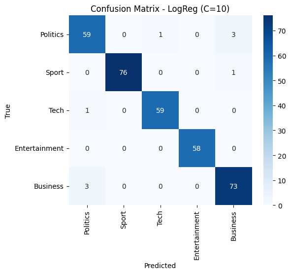
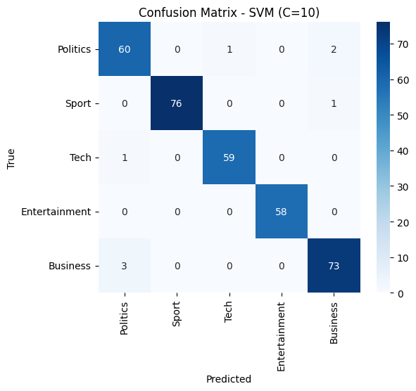

# News topic classification: TF-IDF from scratch + linear models

Classifies 2,225 news articles into five topics (**Politics, Sport, Technology, Entertainment, Business**). The TF-IDF vectorizer is written by hand (no `TfidfVectorizer`); the classifiers are scikit-learn's `LinearSVC` and `LogisticRegression`. Everything is in one notebook with saved outputs: [`tfidf_news_classification.ipynb`](tfidf_news_classification.ipynb).

## Results

Test set (334 articles, seed 42, stratified 70/15/15 split). Hyperparameters were chosen on the validation set and the winner was retrained on train + validation before the single test evaluation.

| Features | Selected model | Accuracy | Macro-Precision | Macro-Recall | Macro-F1 |
|---|---|---|---|---|---|
| Unigrams | Logistic Regression, C=10 | 0.973 | 0.974 | 0.973 | 0.974 |
| Unigrams + bigrams | LinearSVC, C=10 | 0.976 | 0.976 | 0.977 | 0.976 |

Per-class F1 is 1.000 for Entertainment, 0.993 for Sport, 0.983 for Tech, and the lowest for **Politics (0.937 / 0.945)** and **Business (0.954 / 0.961)** (unigram / bigram). Politics and Business are mostly confused with each other.

| Unigram (9 errors) | Unigram + bigram (8 errors) |
|---|---|
|  |  |

**Do bigrams help?** Macro-F1 differs by 0.003, which is **one article out of 334**: not a measurable difference. Words alone already separate these topics.

The notebook also contains the full validation grids, per-class precision/recall/F1 tables and a discussion of alternative models (kernel SVMs, neural networks).

## How the pipeline works

1. **Preprocessing:** lowercase, keep a-z only, NLTK tokenization, English stop-word removal.
2. **Split:** stratified 70 / 15 / 15 with seed 42 (1,557 / 334 / 334 articles).
3. **TF-IDF:** `w = (1 + ln tf) * ln(N / df)`, with the vocabulary and document frequencies computed from the training set only, then L2-normalized. The bigram setting adds tokens such as `stock_market`.
4. **Models:** LinearSVC and Logistic Regression (L2), C in {0.1, 1, 10}; selection by validation Macro-F1.
5. **Evaluation:** accuracy, macro precision/recall/F1, per-class table, confusion matrix.

I checked the hand-written TF-IDF against a manual calculation on a small example (`compute_df` / `compute_tfidf` match the formula, and unseen terms are ignored).

## Run it

```bash
pip install -r requirements.txt
jupyter notebook tfidf_news_classification.ipynb
```

The dataset is not included. Put `df_file.csv` next to the notebook; it needs the columns `Text` and `Label` (0 Politics, 1 Sport, 2 Tech, 3 Entertainment, 4 Business). The notebook downloads the NLTK data it needs on first run.

With scikit-learn 1.8 or newer, `LogisticRegression(penalty='l2')` prints a `FutureWarning` (the parameter is being phased out). It is harmless.

## Notes and limitations

- **One split, one seed.** Differences of a few tenths of a percentage point (such as unigram vs. bigram) are within the noise; cross-validation would be needed to rank them reliably.
- **Logistic Regression is not literally one-vs-rest.** scikit-learn's default for this solver is a multinomial (softmax) model. `LinearSVC` is one-vs-rest.
- **Dense matrices.** TF-IDF is stored as a dense NumPy array, which is fine for 2,225 articles but would need `scipy.sparse` for larger corpora or bigger bigram vocabularies.
- **Preprocessing removes every non-letter without inserting a space,** so hyphenated words are joined and contractions such as "don't" become "dont", which the stop-word list no longer recognizes.
- If the dataset contains duplicate articles, copies can land in both train and test and inflate the scores; worth checking with `df.duplicated()`.
